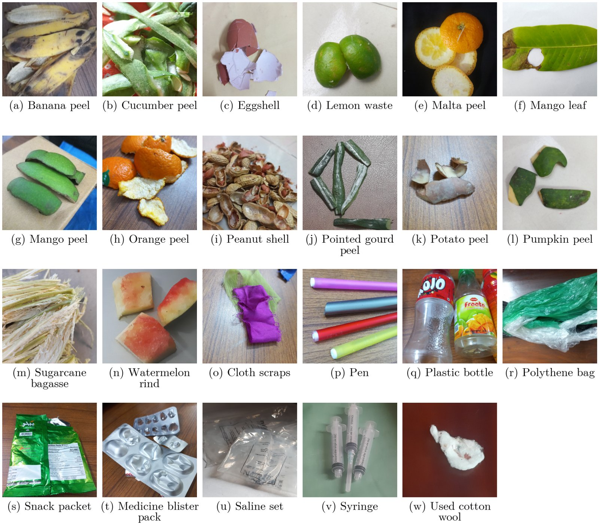
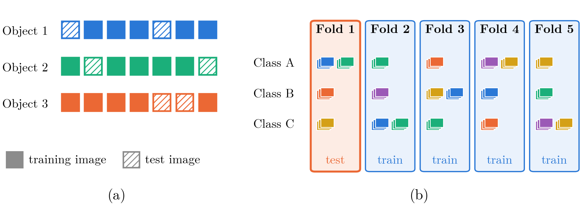
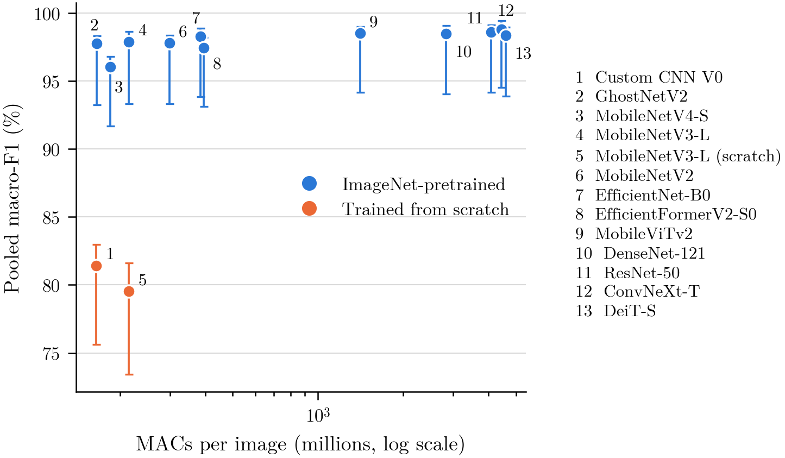
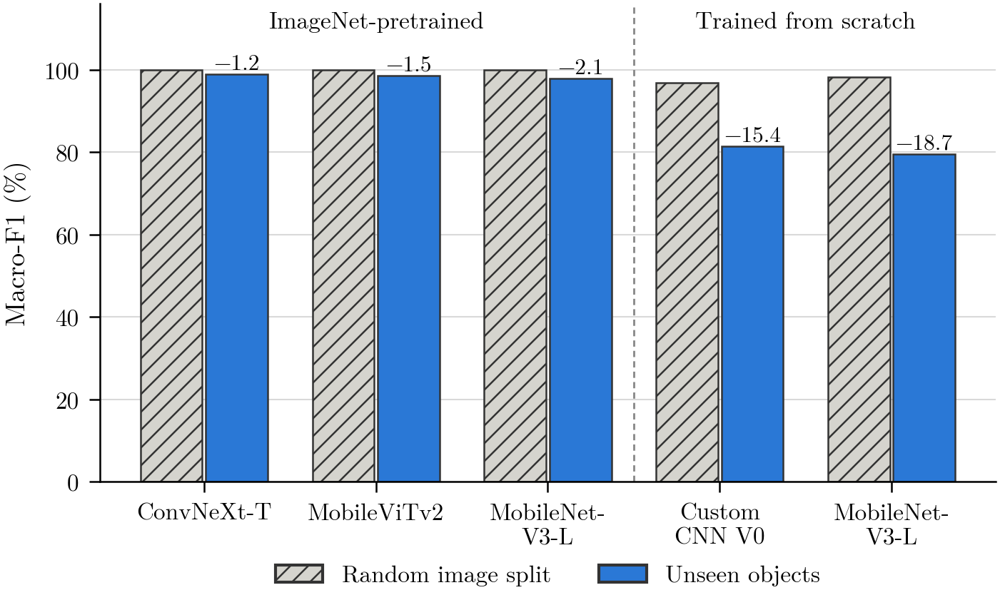
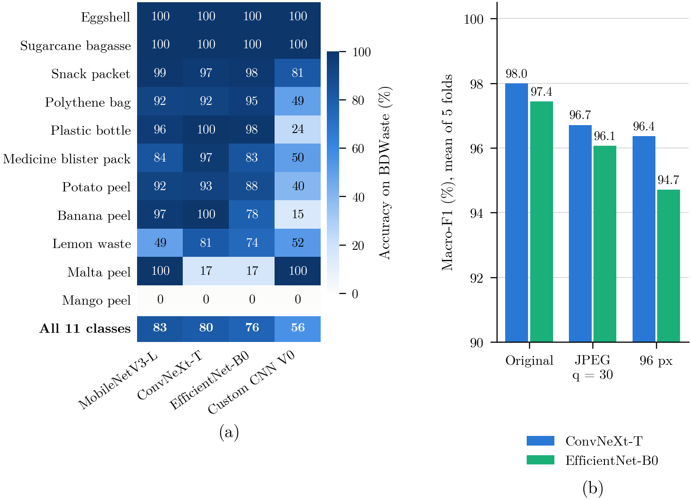

<div align="center">

# BanglaWaste-23

**A household and hospital waste image dataset from Bangladesh, with an object-disjoint benchmark**

[](LICENSE)
[](https://creativecommons.org/licenses/by-nc/4.0/)
[](#citation)
[](#citation)
[](https://github.com/huggingface/pytorch-image-models)

</div>

This repository accompanies the paper

> **Do Waste Classifiers Recognise Items They Have Never Seen? Object-Disjoint Evaluation on Household and Medical Waste.**
> Nusrat Jahan, Mst. Eshrat Jahan Esha, Masuma Sadia, Saad Ahmed, Md Zahim Hassan, S M Jahangir Alam. *Waste Management* (under review).

It holds the data-preparation scripts, the exact evaluation splits, the training notebooks, all saved predictions and
metrics, and the scripts that rebuild every figure and table of the paper. The images themselves are on
[Zenodo](#download).

<p align="center"></p>

## Contents

- [Highlights](#highlights)
- [The dataset](#the-dataset)
- [Download](#download)
- [Evaluation protocol and splits](#evaluation-protocol-and-splits)
- [Benchmark results](#benchmark-results)
- [Repository structure](#repository-structure)
- [Getting started](#getting-started)
- [Reproducing the paper](#reproducing-the-paper)
- [Citation](#citation)
- [Licence](#licence)
- [Acknowledgements](#acknowledgements)

## Highlights

- **4,160 real smartphone images in 23 classes, at original resolution**, covering food and plant waste, household
  waste, and medical waste collected at a hospital.
- **172 physical-object IDs.** Every image is linked to the item it shows, with each item's capture conditions (indoor or
  outdoor, lighting, background).
- **An object-disjoint benchmark.** No item appears in both training and test data. It covers 11 tuned ImageNet-pretrained
  models and two models trained from scratch.
- **Random splits mislead.** A random image split overstates accuracy on new objects by **15–19 points** for models
  trained from scratch, and gives about 100% to every pretrained model, so the models cannot be ranked.
- **Medical safety, robustness and transfer.**
  - **Medical recall:** pretrained models find 99–100% of medical items; from-scratch models find only 87–89%.
  - **No shortcut found:** the image-quality and per-device checks show no shortcut.
  - **Cross-region drop:** a model trained in northern Bangladesh loses 15–20 points on images from Dhaka.

## The dataset

| | |
|---|---|
| Images | 4,160 JPEG, 8-bit RGB; 87.8% are 3456×3456 or 2992×2992; shorter side ≥ 513 px |
| Classes | 23 (141–211 images per class), in 3 groups |
| Physical objects | 172 (5–10 per class, 3–77 images per object, median 20) |
| Where | Saidpur (Nilphamari): households, hostels, campus canteen, market and street; medical items at Hasan General Hospital, Thakurgaon (with permission) |
| Phones | Samsung Galaxy M31 and M32, Xiaomi Redmi Note 11, vivo Y20i (Open Camera app) |
| Quality control | 821 of 4,981 photos removed (blur, darkness, wrong item, duplicates); labels cross-checked by two people; medical classes verified by a nurse |
| Licence | CC BY-NC 4.0 |

<details>
<summary><b>All 23 classes</b> (group, item, folder name, images, objects)</summary>

| Group | Item | Folder | Images | Objects |
|---|---|---|---:|---:|
| Food and plant | Banana peel | `Banana_peeling` | 156 | 5 |
| Food and plant | Cucumber peel | `cucumber_peeling` | 152 | 9 |
| Food and plant | Eggshell | `Egg` | 211 | 5 |
| Food and plant | Lemon waste | `Lemon` | 156 | 6 |
| Food and plant | Malta peel | `malta_peeling` | 141 | 6 |
| Food and plant | Mango leaf | `mango_leaf` | 186 | 5 |
| Food and plant | Mango peel | `mango_peeling` | 155 | 8 |
| Food and plant | Orange peel | `orange_peeling` | 211 | 10 |
| Food and plant | Peanut shell | `nut` | 165 | 8 |
| Food and plant | Pointed gourd peel | `pointed_gourd_peeling` | 192 | 8 |
| Food and plant | Potato peel | `potato_peeling` | 167 | 5 |
| Food and plant | Pumpkin peel | `pumpkin` | 164 | 10 |
| Food and plant | Sugarcane bagasse | `sugarcane` | 206 | 6 |
| Food and plant | Watermelon rind | `watermelon` | 150 | 9 |
| Household non-food | Cloth scraps | `cloth` | 208 | 9 |
| Household non-food | Pen | `pen` | 190 | 6 |
| Household non-food | Plastic bottle | `Bottle` | 204 | 8 |
| Household non-food | Polythene bag | `polythene` | 154 | 10 |
| Household non-food | Snack packet | `packet` | 211 | 7 |
| Medical | Medicine blister pack | `medicine` | 169 | 5 |
| Medical | Saline (IV infusion) set | `saline` | 209 | 10 |
| Medical | Syringe | `Injection` | 203 | 9 |
| Medical | Used cotton wool | `cotton` | 200 | 8 |
| **Total** | | | **4,160** | **172** |

Food and plant: 2,412 images (100 objects) · Household non-food: 967 (40) · Medical: 781 (32).
</details>

**Metadata** (in [`metadata/`](metadata), identical to the Zenodo release):

| File | Contents |
|---|---|
| `image_metadata.csv` | One row per image: file, class, object ID, phone, size, indoor/outdoor, lighting, background |
| `objects.csv` | One row per object: class, number of images, capture conditions |
| `file_list.csv` | Every file with its MD5 checksum (for verifying the download) |
| `class_summary.csv` | Per-class counts, resolutions, file sizes and phones |

## Download

The images are on Zenodo: **DOI: [10.5281/zenodo.23694940](https://doi.org/10.5281/zenodo.23694940)** (resolves to the latest version). Access is restricted while the paper is under review, and the record will be
public on publication. Extract the archive so that the images sit in the repository root like this:

```
BanglaWaste-23-raw/
├── Banana_peeling/
│   ├── Banana_peeling_img_00001.jpg
│   └── ...
├── Bottle/
└── ...            (23 class folders, 4,160 images)
```

Then check the download: `python script/01_verify_dataset.py` should end with `RESULT: PASS`.

## Evaluation protocol and splits

Each object was photographed many times. A random image split therefore puts near-identical views of the same object
in both training and test data, and in this dataset 155 of the 172 objects end up on both sides. We instead use
**object-disjoint 5-fold cross-validation**: whole objects are assigned to folds, and every class appears in every fold.

<p align="center"></p>

| File in [`splits/`](splits) | Purpose |
|---|---|
| `folds.csv` | **Main evaluation**: object-disjoint 5 folds (fold sizes 848 / 936 / 811 / 740 / 825 images) |
| `fold0_val.csv` | Tuning only: one object per class held out from the training folds (2,689 / 623 images) |
| `random_split.csv` | Leakage comparison only: stratified 70/15/15 random image split |
| `class_map.csv` | Class index, readable name and group |

The splits are deterministic (seed 42), and `script/03_make_splits.py` rebuilds them exactly. Details are in
[`splits/README.md`](splits/README.md).

## Benchmark results

The table reports pooled out-of-fold macro-F1 on unseen objects over all 4,160 images. The 95% confidence intervals
come from a bootstrap over the 172 objects. All pretrained models are fully fine-tuned for 40 epochs with a learning
rate tuned per model; the from-scratch models are trained for 150 epochs.

| Model | Training | Params (M) | MACs (M) | Macro-F1 % [95% CI] |
|---|---|---:|---:|---|
| ConvNeXt-T | ImageNet-pretrained | 27.8 | 4,455 | **98.82** [94.5, 99.4] |
| ResNet-50 | ImageNet-pretrained | 23.6 | 4,087 | 98.62 [94.2, 99.1] |
| MobileViTv2 | ImageNet-pretrained | 4.4 | 1,412 | 98.52 [94.2, 99.0] |
| DenseNet-121 | ImageNet-pretrained | 7.0 | 2,833 | 98.47 [94.1, 99.1] |
| DeiT-S | ImageNet-pretrained | 21.7 | 4,599 | 98.37 [93.9, 99.0] |
| EfficientNet-B0 | ImageNet-pretrained | 4.0 | 385 | 98.29 [93.9, 98.9] |
| MobileNetV3-L | ImageNet-pretrained | 4.2 | 215 | 97.91 [93.3, 98.7] |
| MobileNetV2 | ImageNet-pretrained | 2.3 | 300 | 97.80 [93.3, 98.4] |
| GhostNetV2 | ImageNet-pretrained | 4.9 | 166 | 97.76 [93.3, 98.3] |
| EfficientFormerV2-S0 | ImageNet-pretrained | 3.3 | 396 | 97.43 [93.1, 98.2] |
| MobileNetV4-S | ImageNet-pretrained | 2.5 | 185 | 96.03 [91.7, 96.8] |
| Custom CNN V0 | from scratch | 0.38 | 165 | 81.42 [75.6, 83.0] |
| MobileNetV3-L | from scratch | 4.2 | 215 | 79.54 [73.4, 81.6] |

The top six models are not significantly different from each other (McNemar test with Holm correction).
EfficientNet-B0 and MobileViTv2 reach that level with 3–12× less compute than ConvNeXt-T.

<p align="center"></p>

**A random split overstates accuracy on new objects.** Bars compare the same models under a random image split and on
unseen objects; labels give the gap in points.

<p align="center"></p>

**Cross-region and robustness.** Models trained on BanglaWaste-23 were tested on 1,390 images from BDWaste, a dataset
collected in Dhaka, over the 11 classes the two datasets share. They lose 15–20 points, and mango peel drops to 0% for
every model. Degrading image quality costs only 1–3 points.

<p align="center"></p>

All numbers are in [`results/`](results) and [`results/paper/tables/`](results/paper/tables).

## Repository structure

```
BanglaWaste-23/
├── metadata/              release metadata (per image, per object, MD5 list, class summary)
├── splits/                evaluation splits used in the paper
├── script/                data preparation: verify, resize, make splits, checks, Kaggle zip, BDWaste
├── code/
│   ├── pretrained/        11 pretrained models: LR tuning (round1_pilot), 5-fold benchmark + random split (round2_main)
│   ├── custom/            custom-model pilot: V0, redesign, knowledge distillation, pretrained backbone + custom neck
│   ├── batch3/            from-scratch V0 and MobileNetV3-L, shortcut test, Grad-CAM, BDWaste cross-dataset test
│   ├── object_grouping/   how the 172 object IDs were assigned and reviewed
│   └── paper/             rebuild every figure and table (CPU only)
├── results/               aggregated results: summaries, out-of-fold predictions, per-class metrics, figures, tables
├── runs/                  raw logs of every training run (per-epoch history, per-fold metrics and predictions)
├── assets/                images used in this README
├── REPRODUCE.md           full step-by-step reproduction guide
├── requirements.txt
├── CITATION.cff
└── LICENSE
```

## Getting started

```bash
git clone https://github.com/saadbaust/BanglaWaste-23.git
cd BanglaWaste-23
pip install -r requirements.txt
```

**Rebuild all figures and tables from the saved results** (no GPU, no images needed):

```bash
python code/paper/waste_make_figures_tables.py      # -> results/paper/figures, results/paper/tables
python code/paper/waste_make_manuscript_items.py    # protocol diagram, combined figure, journal-style tables
```

**Evaluate your own model on the same splits:**

```python
import pandas as pd

folds = pd.read_csv("splits/folds.csv")   # file_name, class_folder, class_id, group, object_id, device, fold
for k in range(5):
    train, test = folds[folds.fold != k], folds[folds.fold == k]
    assert not set(train.object_id) & set(test.object_id)          # no object on both sides
    # image path: BanglaWaste-23-raw/<class_folder>/<file_name>
    # train on `train`, predict `test`, keep the predictions
# report macro-F1 pooled over the out-of-fold predictions of all 4,160 images
```

Tune only on `fold0_val.csv` (or inside the training folds), never on the test fold.

## Reproducing the paper

[`REPRODUCE.md`](REPRODUCE.md) describes every step:

1. **Data:** verify the download, resize (EXIF rotation, shorter side 256 px), rebuild the splits (`script/01–05`).
2. **Training:** run the Kaggle notebooks on an NVIDIA T4. The guide lists which notebook runs which experiment. Each
   notebook contains its full training code, which is also available as plain Python in `code/*/*_core.py`.
3. **Analysis:** collect the run outputs into `results/` (`code/*/analysis/`).
4. **Figures and tables:** `code/paper/`.

Training settings shared by all models:
- AdamW, batch size 32, warm-up followed by cosine decay.
- MixUp and CutMix, random resized crop 224, flips, rotation and brightness/contrast jitter.
- Mixed precision, with the EMA weights evaluated after the last epoch.
- No early stopping, no test-time augmentation, no class weights.

## Citation

If you use the dataset, the splits or the code, please cite the paper and the dataset. The arXiv identifier will be
filled in once the preprint is online; the journal reference will be added on publication.

**Paper (arXiv preprint):**

```bibtex
@misc{jahan2026banglawaste23,
  title         = Do waste classifiers recognise items they have never seen? Object-disjoint evaluation on household and medical waste},
  author        = {Jahan, Nusrat and Esha, Mst. Eshrat Jahan and Sadia, Masuma and Ahmed, Saad and Hassan, Md Zahim and Alam, S M Jahangir},
  year          = {2026},
  eprint        = {XXXX.XXXXX},
  archivePrefix = {arXiv},
  primaryClass  = {cs.CV},
  doi           = {10.48550/arXiv.XXXX.XXXXX},
  url           = {https://arxiv.org/abs/XXXX.XXXXX}
}
```

**Dataset (Zenodo):**

```bibtex
@misc{banglawaste23_dataset,
  title     = {{BanglaWaste-23}: A Fine-Grained Image Dataset of Household and Medical Waste from Bangladesh},
  author    = {Jahan, Nusrat and Esha, Mst. Eshrat Jahan and Sadia, Masuma and Ahmed, Saad and Hassan, Md Zahim and Alam, S M Jahangir},
  year      = {2026},
  publisher = {Zenodo},
  doi       = {10.5281/zenodo.23694940},
  url       = {https://doi.org/10.5281/zenodo.23694940}
}
```

GitHub's "Cite this repository" button uses [`CITATION.cff`](CITATION.cff).

## Licence

- **Code** (`script/`, `code/`) is under the [MIT License](LICENSE).
- **Images, metadata, splits and results** (`metadata/`, `splits/`, `results/`, `runs/`, Zenodo) are under
  [CC BY-NC 4.0](https://creativecommons.org/licenses/by-nc/4.0/). You may use them for non-commercial purposes, with
  attribution.

## Acknowledgements

- We thank the Managing Director of Hasan General Hospital, Thakurgaon, for permission to collect and photograph medical
  waste items, and the nurse who verified the medical labels.
- Training ran on free Kaggle GPUs.
- Models come from [timm](https://github.com/huggingface/pytorch-image-models).
- The cross-dataset test uses BDWaste (Rahman et al., 2024, *Data in Brief*).

**Authors:**
- Nusrat Jahan, Mst. Eshrat Jahan Esha and Masuma Sadia (equal contribution)
- Saad Ahmed (corresponding author), Md Zahim Hassan, S M Jahangir Alam (corresponding author)

All are with the Department of Computer Science and Engineering, Bangladesh Army University of Science and Technology
(BAUST), Saidpur, Bangladesh. For questions, please open an [issue](https://github.com/saadbaust/BanglaWaste-23/issues).
